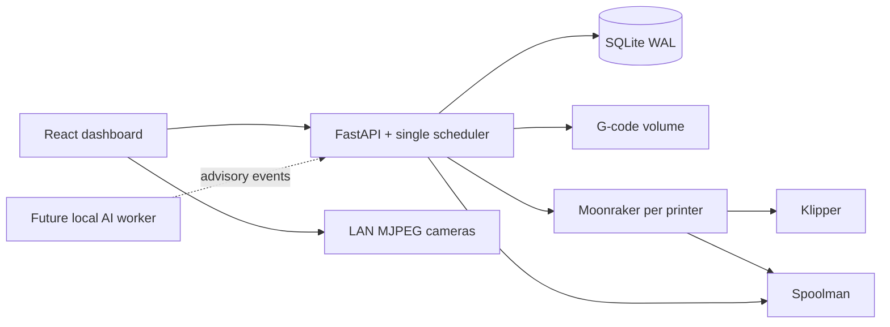

# PrintForge architecture

Status: initial MVP design, 8 November 2026. Decisions below are implementation defaults, not previously approved user preferences.

## Purpose and scope

Free, self-hosted, original AGPL-3.0-or-later software for a Klipper farm, without printer-count limits. Moonraker owns printer communication; Spoolman owns filament inventory and consumption. PrintForge owns the central queue, compatibility matching, reservations, operator clearance and its job history. Inspiration is functional; no SimplyPrint, FDM Monster or O.D.I.N. code or branding is copied.

## Approaches

1. Extend an existing manager: fastest if its scheduler/data model fits, but couples the result to upstream licensing and architecture.
2. A modular application with integrated scheduler: selected for the MVP. React/TypeScript UI, FastAPI service, SQLite WAL, immutable G-code uploads, HTTP adapters. One service and one local persistent volume are straightforward to operate and test.
3. Separate API, scheduler and PostgreSQL services: planned when scaling or multi-user needs justify them. The earlier chat suggested this target; it is not needed for the first single-host MVP.

## Components

The API serves the compiled frontend. A process lock prevents two service instances sharing the same database. A single scheduler executes at five-second intervals; application mutations and scheduler ticks serialize. A restart never blindly reissues a start command whose outcome is uncertain.

## Domain and matching

- Printer: operator-set profile identifier, XYZ build volume, nozzle, material, colour, active spool ID, Moonraker URL/API key, optional MJPEG camera URL, enabled and bed-clear flags, latest telemetry.
- File: immutable UUID, original filename and checksum. MVP accepts already-sliced G-code only; no STL slicing.
- Job: one physical copy, batch ID, source file, profile, dimensions, nozzle/material/optional colour, estimated grams and duration, earliest UTC start, priority, state, printer reservation and history timestamps.
- Spool: Spoolman ID, material, colour, remaining grams. Reservations are maintained by PrintForge against jobs currently dispatching/running/held.

A profile is an operator assertion of identical G-code/start-macro compatibility, not an inference from bed size. Exact profile and nozzle, sufficient volume, loaded material/colour and available spool grams must match. Known spool inventory must be fresh for dispatch. One physical spool may be assigned to only one printer. Jobs sort by priority, earliest start and creation order. Matching is first-fit, not an optimizer or deadline guarantee.

## Dispatch contract

Queued → dispatching → running → completed/failed/cancelled. Any ambiguous dispatch or interrupted print becomes needs_attention and retains its reservation. PrintForge commits the job/printer reservation and consumes the bed-clear flag BEFORE uploading or starting. It checks fresh idle telemetry, sets the active Moonraker spool, uploads to a unique filename, rechecks readiness, then starts. It never retries an uncertain start automatically. Operators resolve held jobs only after inspecting the printer; another bed-clear acknowledgement is still required.

Only exact filename telemetry can finish a tracked job. Offline, paused, disconnected or unmatched work blocks further dispatch. Pause is not completion. Manual/out-of-band printing invalidates the previous bed-clear acknowledgement. On service restart all bed-clear flags reset. A connection interruption also invalidates clearance.

Reservations prevent concurrent PrintForge jobs from overcommitting inventory. They do not coordinate unrelated external schedulers. Run only PrintForge as the dispatcher for managed printers. Spoolman is the inventory authority; Moonraker reports extrusion, so PrintForge does not write consumption.

Moonraker clears its pending-report collection before awaiting the inventory write, so an empty collection cannot prove consumption committed. PrintForge therefore persists a separate conservative budget per spool, debits estimated grams before dispatch, and allows automatic inventory reads only to lower it. Schedulable grams are the lower of that budget and observed weight less active reservations. Completed jobs cannot immediately spend stale inventory. Overestimates, refills, or uncertain jobs may leave a hold: an operator can reconcile only after verifying Spoolman's actual balance includes all usage or a physical re-weigh. This is deliberately conservative and still depends on honest job estimates; it cannot guarantee a print will finish if the supplied estimate understates actual usage.

## Security and operations

Demo mode uses simulated printers and cannot connect to real machines. Real mode requires a strong administrator API token; the browser keeps it in memory and sends a bearer header. No public registration. Credentials stay server-side, omitted from API responses. Deploy on a trusted LAN/VPN; use TLS at a reverse proxy before remote access. Direct camera streams require browser access to the LAN and a compatible HTTP/HTTPS scheme; MVP has no WebRTC gateway or authenticated camera proxy.

Persist database and uploaded G-code together on a local Docker volume. The MVP stores atomic versioned farm snapshots in SQLite rather than a fully relational schema; this keeps reservations and budget debits in one commit. Stop the service before filesystem backup. No NFS database, multiple replicas, or multiple Uvicorn workers. Docker Compose and a prebuilt-image Portainer stack are provided; a registry image is not yet published. No deployment or real printer actions are performed during this build.

Initial fleet inventory: one Qidi X-Plus 3, two CR-10s, one CR-30, one Ender 3 and one resin printer of unconfirmed model. The user reports all run Klipper. Hardware dimensions, nozzle, material and profile compatibility must still be confirmed. CR-30 belt and resin entries are inventory-only for M1 even if Moonraker is reachable, because their process semantics need separate support. Two clearly labeled FDM simulators exist only in demo mode. Real fleet entries start disabled with unconfigured dimensions.

## Milestones and acceptance

| Milestone | Deliverable | Acceptance |
|---|---|---|
| M1 — Working MVP (this build) | Dashboard, camera URLs, printer setup, G-code library, central batch queue, scheduled starts, matching, reservations, history, Moonraker/Spoolman adapters, simulation, Docker | Automated scheduler/API tests, frontend build, browser smoke test; real hardware acceptance remains pending |
| M2 — Hardware pilot | Connect one printer, then a small homogeneous group; verify all restart/disconnect paths and actual spool consumption | One complete supervised batch, no duplicate starts, no start without bed clearance |
| M3 — Reliable farm operations | PostgreSQL/migrations, separate leased worker when required, WebSocket telemetry, users/roles, richer audit and camera proxy | Recovery and concurrency tests under production-shaped load |
| M4 — Local AI monitoring | Optional local inference worker or self-hosted Obico integration; time-windowed alerts and explicit policy for pausing | Tested model/license choice, recorded false positives/negatives; no automatic resume |
| M5 — Release and analytics | Metrics/costs, notifications, maintenance, backups/restores, signed images and upgrade process | Reproducible release, restore drill, pilot feedback resolved |

AI detection, automatic slicing, recurring calendar schedules, timelapses, sophisticated optimization and physical bed clearing are explicitly outside M1. No placeholder detection is represented as working AI.

## Sources

- https://moonraker.readthedocs.io/en/latest/web_api/
- https://moonraker.readthedocs.io/en/latest/configuration/#spoolman
- https://github.com/Donkie/Spoolman
- https://docs.docker.com/engine/install/debian/
